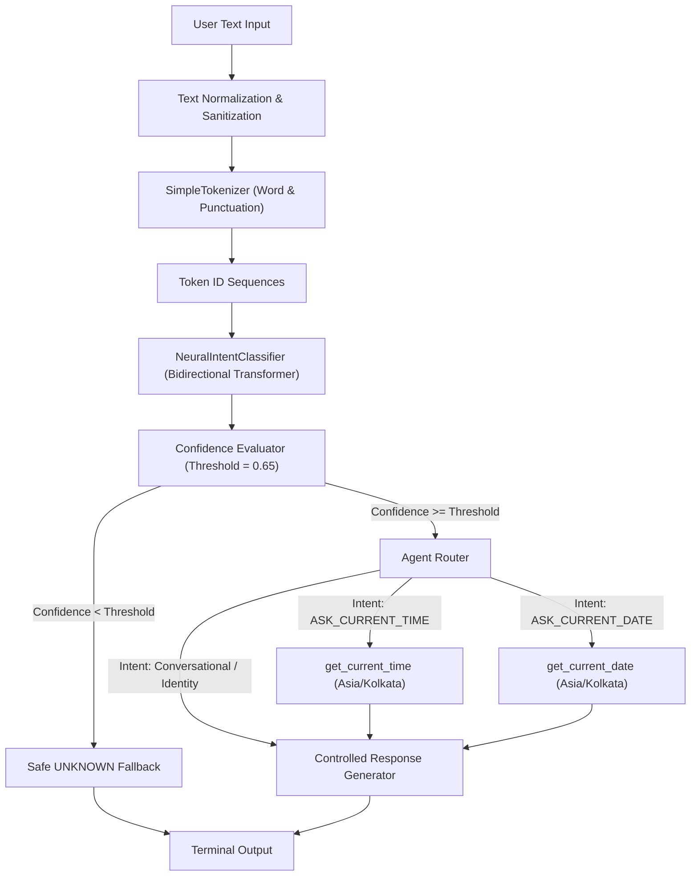

# Nova Architecture & System Design

Nova is an educational AI system built completely from scratch in Python and PyTorch. It demonstrates how modern language models and AI agents function by exposing every internal component: tokenization, attention mechanisms, autoregressive next-token prediction, neural intent classification, deterministic confidence routing, and sandboxed tool calling.

---

## 1. High-Level Architecture Overview

Nova uses a **hybrid architecture** that combines a learned neural understanding layer with deterministic application logic and sandboxed tools.

---

## 2. Core Architectural Distinctions

In modern AI engineering, multiple concepts are frequently conflated. Nova explicitly separates them into distinct, inspectable modules:

| Concept | Nova Implementation | Role & Boundaries |
| :--- | :--- | :--- |
| **Tokenizer** | [`src/nova/tokenizer/tokenizer.py`](file:///d:/AI/hello_ai/src/nova/tokenizer/tokenizer.py) | Converts raw Unicode text strings into discrete integer token sequences and back. Contains no neural weights. |
| **Decoder Language Model** | [`src/nova/models/language_model.py`](file:///d:/AI/hello_ai/src/nova/models/language_model.py) | Autoregressively predicts $P(w_t \mid w_{<t})$ using causal multi-head self-attention. Generates raw text continuations. |
| **Neural Intent Classifier** | [`src/nova/models/intent_classifier.py`](file:///d:/AI/hello_ai/src/nova/models/intent_classifier.py) | Encodes bidirectional sequences to classify user goal into discrete intent labels with softmax confidence scores. |
| **Rule Baseline** | [`src/nova/models/intent_classifier.py`](file:///d:/AI/hello_ai/src/nova/models/intent_classifier.py) | Deterministic pattern-matching baseline for diagnostic comparison against neural predictions. |
| **Confidence Evaluator** | [`src/nova/agent/confidence.py`](file:///d:/AI/hello_ai/src/nova/agent/confidence.py) | Applies confidence thresholds to detect out-of-domain or ambiguous inputs, routing them to safe fallbacks. |
| **Tool Registry** | [`src/nova/tools/registry.py`](file:///d:/AI/hello_ai/src/nova/tools/registry.py) | Strictly allowlisted registry of Python callables. Does not execute arbitrary model code or use `eval`. |
| **Response Generator** | [`src/nova/agent/response_generator.py`](file:///d:/AI/hello_ai/src/nova/agent/response_generator.py) | Controlled template and factual response formatter referencing [`config/identity.yaml`](file:///d:/AI/hello_ai/config/identity.yaml). Prevents hallucination. |
| **AI Agent** | [`src/nova/agent/router.py`](file:///d:/AI/hello_ai/src/nova/agent/router.py) | The orchestrator coordinating input normalization, neural classification, threshold gating, tool execution, and final response formatting. |

---

## 3. Data Flow Step-by-Step

When a user submits input in interactive mode or via API:

1. **Validation & Normalization:**
   - Trims whitespace and strips non-printable characters.
   - Preserves sentence boundaries and punctuation (`?`, `!`, `.`).
   - Normalizes casing (lowercasing).

2. **Tokenization:**
   - Splits input into word and punctuation tokens using compiled regex rules.
   - Maps each token to integer IDs using the learned vocabulary. Unseen words are mapped to `<UNK>`.
   - Adds special tokens (`<BOS>`, `<EOS>`) and pads/truncates to `max_seq_len`.

3. **Neural Intent Classification:**
   - Input tensor passed through `NeuralIntentClassifier`.
   - Non-causal self-attention allows all tokens to attend bidirectionally.
   - Mean-pooling over non-padding tokens extracts a fixed-size semantic representation vector.
   - Dense linear projection outputs logits across the 12 supported intents.

4. **Confidence Scoring & Routing:**
   - Logits converted to pseudo-probabilities via Softmax.
   - Top candidate intent and confidence $c = \max(\text{softmax}(\mathbf{z}))$ extracted.
   - If $c < \text{threshold}$ (default: 0.65), effective intent is overridden to `UNKNOWN`.

5. **Tool Execution (Sandboxed):**
   - If the intent requires dynamic system information (`ASK_CURRENT_TIME` or `ASK_CURRENT_DATE`), the router queries the `ToolRegistry`.
   - The registry verifies the tool name against an allowlist and executes the standard Python function in the `Asia/Kolkata` timezone.
   - If execution fails, structured error metadata is returned safely without raising an unhandled exception.

6. **Controlled Response Synthesis:**
   - Dynamic tool data is formatted into natural English (e.g., `"It is currently 10:30 AM IST."`).
   - Conversational and identity queries retrieve verified responses from [`config/identity.yaml`](file:///d:/AI/hello_ai/config/identity.yaml).
   - The complete response string along with execution traces is returned to the user terminal.

---

## 4. Decoder Language Model Subsystem

Nova also includes a dedicated, standalone **DecoderLanguageModel** implementing autoregressive causal language modeling:

```mermaid
graph LR
    Input["Prompt Tokens: [BOS, w1, w2]"] --> Embed["Token + Positional Embeddings"]
    Embed --> Block1["Transformer Block 1 (Causal Mask)"]
    Block1 --> Block2["Transformer Block 2 (Causal Mask)"]
    Block2 --> LN["LayerNorm Final"]
    LN --> Head["Linear Head (d_model -> vocab_size)"]
    Head --> Logits["Vocabulary Logits"]
    Logits --> Sample["Temperature Sampling / Argmax"]
    Sample --> NextToken["Next Token Predicted: w3"]
```

The Decoder LM can be operated independently via `python -m nova.cli generate-lm` to inspect raw neural generation behavior, hallucinations, and sampling dynamics without routing constraints.
